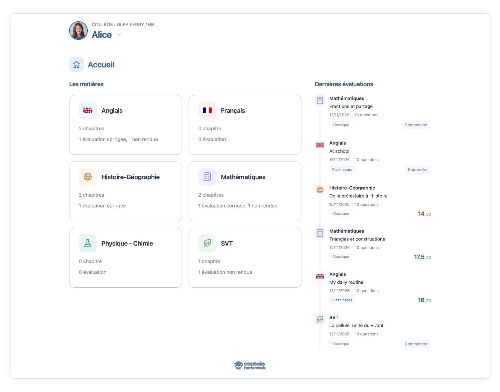
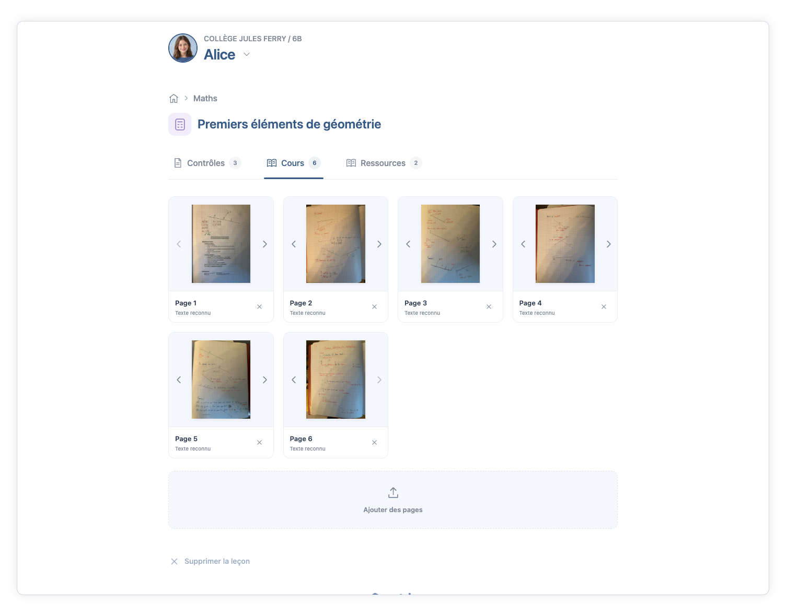
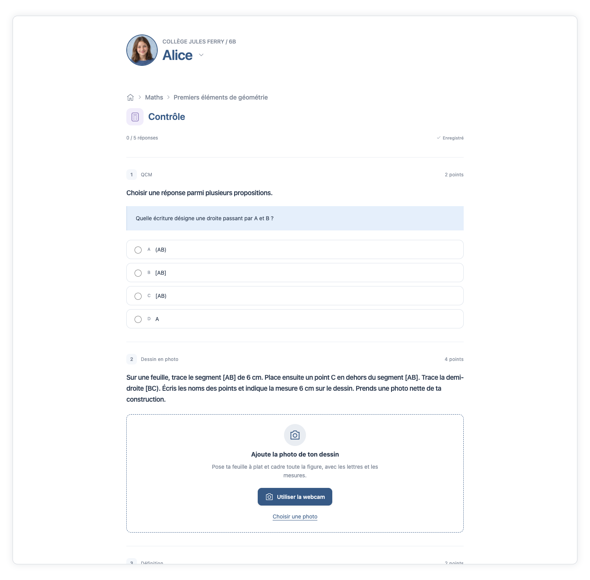
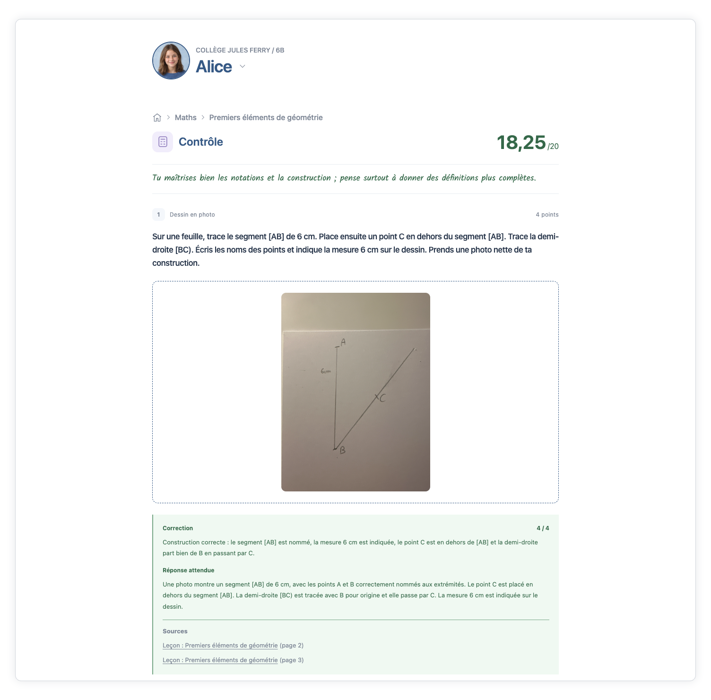
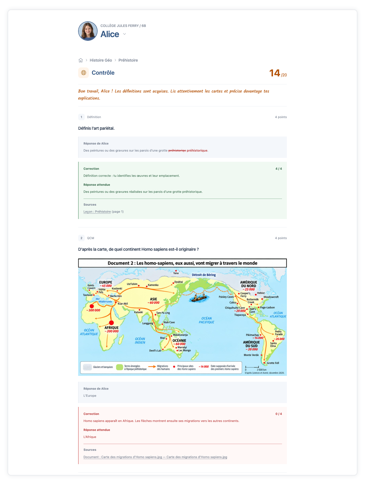
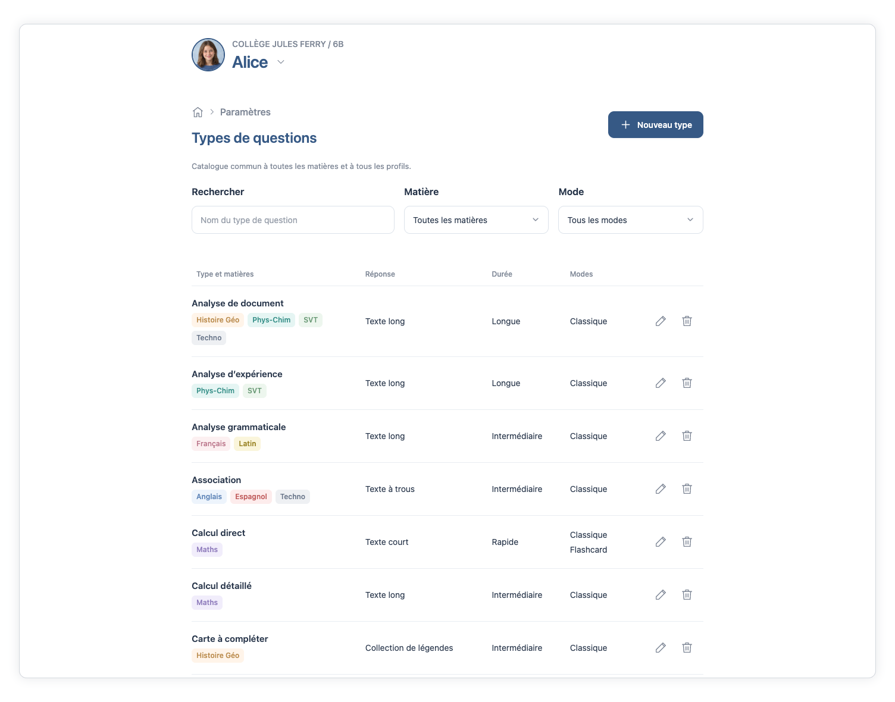
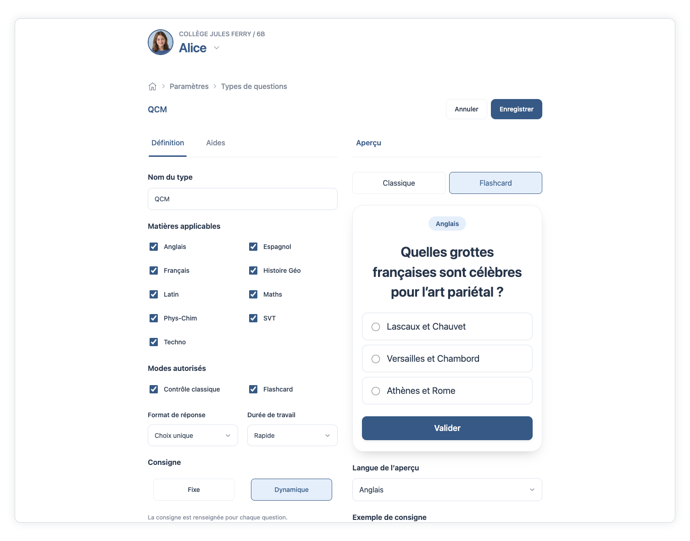
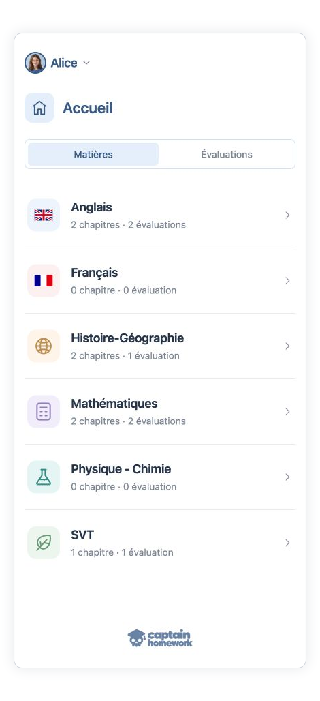
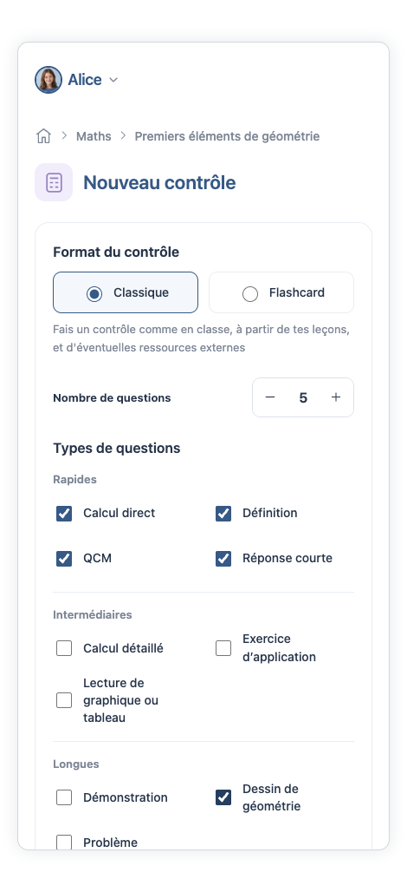
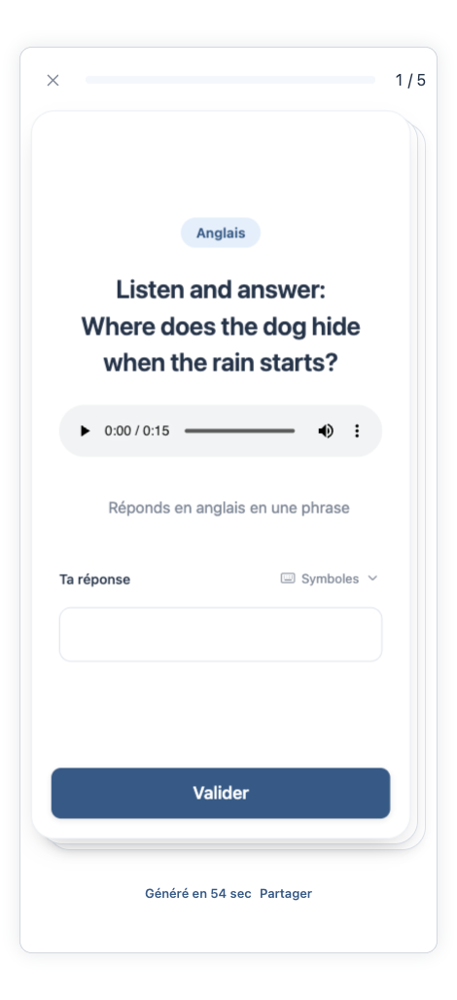

# Captain Homework

## Description du projet

Une application de révision pour les collégiens : importer ses cours, préparer des contrôles et obtenir une correction détaillée, dans un espace dédié à chaque enfant.

Les chapitres sont organisés par matière, alimentées en prenant des photos des cahiers, et éventuellement complétées de ressources externes (photo des livres, cours sur Internet ...).

Vous pouvez ensuite générer des évaluations personnalisées, avec tous types de questions (définition, QCM, schéma ...) pouvant parfois s'appuyer sur des documents externes.

Le contrôle est alors corrigé automatiquement, une note sur 20 est attribué et une correction détaillée par question est fournie.

## Motivations

- Aider les enfants à réviser à partir de leurs propres cours.
- Faciliter la préparation de contrôles variés, équilibrés et ludiques
- Proposer une interface simple, utilisable sur ordinateur, tablette et téléphone.

## Principe de fonctionnement

1. **Lire et organiser les documents** : l’OCR reconnaît le texte des leçons et des ressources. Les notions, objectifs, exercices et illustrations sont organisés en une structure pédagogique.
2. **Préparer le plan d’évaluation** : les notions à travailler et les types de questions sont répartis selon le contenu du chapitre, la durée souhaitée et les consignes personnalisées.
3. **Rédiger les questions** : chaque question est préparée avec son énoncé, ses éventuels documents, la réponse attendue et les critères de correction.
4. **Valider et ajuster** : une relecture indépendante vérifie la cohérence des questions, leur fidélité aux sources et la qualité des supports. Les questions rejetées sont retravaillées sans perdre celles déjà validées.
5. **Répondre et recevoir une correction** : l’élève réalise l’évaluation, puis reçoit une note sur 20 et des explications par question. En Flash cards, la correction apparaît après chaque réponse.


## Techno

- Elixir, Phoenix LiveView et SQLite.
- OpenAI pour la reconnaissance des documents, la génération des contrôles et leur correction.
- Poppler : une suite d’outils pour extraire le texte et les images des PDF.
- ImageMagick pour la compatibilité des illustrations recadrées des anciens contrôles.
- Code massivement généré par intelligence artificielle avec OpenAI Codex.
- Prévu pour tourner avec Docker en production.

## Screenshots

Captures de l’interface avec un seul profil fictif, Alice, et des données anonymisées. [Voir le répertoire screenshots](screenshots/).

### Desktop















### Mobile

<p>
  
</p>

## Lancer le projet en local

Prérequis : Elixir et Erlang/OTP (versions locales dans [.tool-versions](.tool-versions)), ainsi que Poppler et ImageMagick. L’image Docker utilise Elixir 1.19.4 et OTP 28.

Sur macOS, installer les outils de traitement des documents :

```sh
brew install poppler imagemagick ffmpeg yt-dlp node
```

Sur Debian ou Ubuntu, les paquets correspondants sont `poppler-utils` et `imagemagick`. Pour l’import audio, ajouter `ffmpeg`, `yt-dlp` avec ses dépendances par défaut et Node.js 22 ou ultérieur. L’image Docker inclut ces outils.

Les ressources de chapitre acceptent aussi les fichiers MP3 et MP4 (512 Mo, 2 heures maximum). Le bouton existant « Importer depuis une URL » accepte les liens YouTube vers une vidéo publique, y compris les liens courts et Shorts, sans importer de playlist ni de direct. Seule la transcription est conservée et utilisée comme source pour les évaluations ; aucun lecteur audio ni image extraite de vidéo n’est ajouté. Le fichier importé est conservé temporairement pour permettre une reprise après erreur, puis supprimé dès que sa transcription est enregistrée. Les extraits audio temporaires sont nettoyés même en cas d’échec.

La transcription utilise l’API audio OpenAI (`gpt-transcribe`, configurable via `:openai_transcription_model`) avec la configuration API existante, en extraits de dix minutes. Références : [transcription OpenAI](https://developers.openai.com/api/docs/guides/speech-to-text), [yt-dlp](https://github.com/yt-dlp/yt-dlp). YouTube peut refuser certaines vidéos publiques depuis le serveur ; l’import signale alors une erreur et permet de réessayer ou d’importer un fichier local.

```sh
git clone https://github.com/cblavier/captain_homework.git
cd captain_homework
cp -n .env.example .env
```

Compléter le fichier `.env` :

- `OPENAI_API_KEY` : clé API OpenAI.
- `OPENAI_MODEL` : modèle utilisé pour l’OCR, les ressources, la génération et la correction des contrôles classiques, `gpt-5.4` par défaut.
- `OPENAI_ILLUSTRATION_MODEL` : modèle dédié à l’extraction des illustrations, `gpt-6-astra` par défaut, avec un raisonnement `medium` et le détail d’image `original`. Le modèle choisi doit accepter ces réglages et les sorties JSON structurées.
- `OPENAI_FLASHCARD_MODEL` : modèle dédié à la correction après chaque flashcard, `gpt-5.4-mini` par défaut, avec le raisonnement désactivé (`none`) pour réduire l’attente. Le modèle choisi doit accepter ce réglage et les sorties JSON structurées.
- `OPENAI_SPEECH_MODEL` : modèle Realtime de synthèse vocale, `gpt-realtime-2.1-mini` par défaut.
- `HOMEWORK_CHILD_n_FIRST_NAME` : prénom de chaque enfant.
- `HOMEWORK_CHILD_n_SCHOOL_NAME` et `HOMEWORK_CHILD_n_CLASS_NAME` : établissement et classe facultatifs, affichés dans l’en-tête sans connexion à Pronote. Par exemple : `Collège Jean Monnet` et `4A`.
- `HOMEWORK_CHILD_n_AVATAR_BASE64` : avatar facultatif en PNG, JPEG ou WebP encodé en base64.
- `PRONOTE_CHILD_n_THEME` : thème `blue` ou `green`, avec le même numéro que l’enfant. Le nom de variable est partagé avec Captain Notes.
- `PRONOTE_FAMILY_PIN_CODE`, `PRONOTE_CHILD_n_PIN_CODE` et `PRONOTE_PARENT_n_PIN_CODE` : codes PIN à huit chiffres, identiques à Captain Notes. Les comptes numérotés utilisent aussi `PRONOTE_CHILD_n_FIRST_NAME` / `PRONOTE_PARENT_n_FIRST_NAME`. Aucun identifiant ou mot de passe Pronote n’est nécessaire.

En développement derrière un reverse proxy HTTPS, définir `PHX_HOST` sans protocole ni chemin, par exemple `export PHX_HOST=homework.apps.pouet.io` dans `.envrc`. Les liens générés utilisent alors `https://homework.apps.pouet.io`, tandis que le serveur continue d’écouter en HTTP sur le port local 4125 (ou `PORT`). Sans cette variable, l’adresse locale par défaut est conservée. Redémarrer le serveur après modification.

En production, `PHX_HOST` et `SECRET_KEY_BASE` sont obligatoires.

L’OCR utilise un raisonnement `low` ; la préparation des catalogues et la conception des contrôles utilisent un raisonnement `medium`.

```sh
set -a
source .env
set +a
mix setup
mix phx.server
```

Ouvrir [localhost:4125](http://localhost:4125). Après modification des variables, les recharger et redémarrer le serveur. Pour utiliser direnv, ajouter `dotenv .env` dans `.envrc`, puis exécuter `direnv allow`.

Les fichiers `.env`, `.envrc` et `env` ne sont pas versionnés. Sans clé OpenAI, les cours peuvent être importés et leur texte saisi manuellement ; l’analyse des ressources, la génération et la correction nécessitent une connexion IA configurée. Les appels à l’API OpenAI sont facturés sur le compte associé à la clé.

Pour lancer les vérifications :

```sh
mix precommit
```

## Construire et lancer en production avec Docker

Prérequis : Docker avec Buildx et Compose. Depuis le dossier du projet :

```sh
docker buildx build --platform linux/amd64 --load -t captain_homework:local .
cp -n .env.example env
chmod 600 env
```

Le fichier **`env`** contient les variables de l’application, sans `export`. Renseigner la clé OpenAI, les enfants, puis :

- `PHX_HOST` : nom de domaine de l’application, sans protocole ni chemin.
- `SECRET_KEY_BASE` : secret généré avec `mix phx.gen.secret`, à conserver lors des mises à jour.
- Les variables de comptes PIN ci-dessus doivent aussi figurer dans le fichier `env` du NAS. Elles sont lues au démarrage.

Les secrets ne sont pas intégrés à l’image. Ne pas versionner `env`.

### Configuration du stockage

Compose utilise un fichier distinct, **`.env`**, à côté de `docker-compose.yml`, pour configurer le stockage et l’identité Unix du conteneur :

```dotenv
DATA_DIR=./data
APP_UID=1000
APP_GID=1000
DOCKER_PLATFORM=linux/amd64
```

Sur la machine cible, remplacer `APP_UID` et `APP_GID` par les résultats de `id -u` et `id -g` du compte propriétaire du dossier de données. Créer ce dossier et lui donner les droits d’écriture nécessaires. Compose refuse de le créer implicitement.

```sh
mkdir -p data
docker compose up -d
docker compose ps
docker compose logs --tail=100 -f captain_homework
```

La base SQLite est située dans `/app/data/captain_homework.db` et les documents dans `/app/data/uploads`. Les migrations sont appliquées au démarrage de la release. Sauvegarder l’ensemble du dossier de données ; pour une copie simple et cohérente de SQLite et des documents, arrêter le conteneur pendant la sauvegarde.

### Reverse proxy et mises à jour

Le conteneur écoute sur **127.0.0.1:4125** sur la machine hôte. Configurer un reverse proxy avec un certificat valide pour servir `https://<PHX_HOST>` et transmettre les requêtes vers `http://127.0.0.1:4125`, avec `X-Forwarded-Proto: https` et la prise en charge des WebSockets.

Pour transférer l’image vers une autre machine :

```sh
docker save -o captain_homework-image.tar captain_homework:local
```

Transférer l’archive, `docker-compose.yml`, `env` et la configuration Compose `.env`, puis lancer sur la machine cible :

```sh
docker load -i captain_homework-image.tar
docker compose up -d --force-recreate
```

Reconstruire l’image et recréer le conteneur pour chaque mise à jour. Une modification de `env` nécessite aussi de recréer le conteneur. Le point d’entrée `/health` permet de vérifier son état.

Le script [deploy.sh](deploy.sh) automatise la construction et le transfert SSH/SFTP vers un NAS Synology. Configurer `DEPLOY_HOST`, `DEPLOY_PORT`, `DEPLOY_REMOTE_DIR`, `DEPLOY_SFTP_DIR` et `DOCKER_PLATFORM` pour la destination souhaitée. Le script conserve le fichier `env` distant et vérifie l’état du conteneur après le déploiement.

## Licence

Captain Homework est distribué sous [licence MIT](LICENSE). Elle autorise l’utilisation, la modification et la redistribution, y compris commerciales, sous réserve de conserver la notice de copyright et la licence. Le logiciel est fourni sans garantie. Les dépendances et éléments tiers restent soumis à leurs licences respectives.
