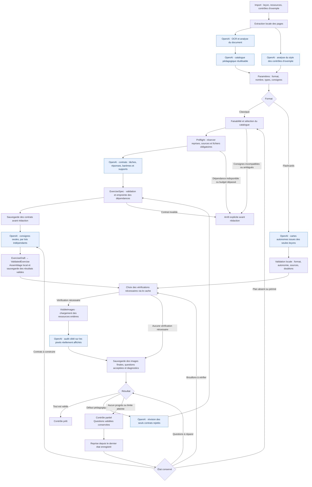

# Génération d’un contrôle

Le serveur Phoenix orchestre les appels à l’API Responses d’OpenAI. Les documents importés, les brouillons, les questions validées et les diagnostics sont enregistrés séparément : une reprise repart du dernier état utile.

## Vue d’ensemble

Les blocs bleus représentent des appels OpenAI ; les autres traitements sont exécutés par l’application.

Une consigne personnalisée déclenche un appel `instructions` avant la préparation du contrôle. Il doit répondre `compatible`, `incompatible` ou `needs_clarification`, avec une sélection et des références cohérentes. Une incompatibilité ou une ambiguïté arrête la chaîne ; aucune boucle de réparation ne modifie silencieusement la demande. Sans consigne particulière, la sélection est locale. Le catalogue et les profils des exemples sont réutilisés tant que leurs sources n’ont pas changé.

Les nouveaux contrôles classiques utilisent `workflow: contract_v1`. Les contrôles et fournisseurs anciens gardent leur chemin compatible ; les flashcards restent sur leur génération autonome.

## Contrats et construction

`ExerciseSpec` est l'entrée versionnée : identité, tâche, type, objectif, compétence, effort, mode de résolution, éléments attendus, références, supports, images, réponse, barème et contenu fixe. Son empreinte inclut les métadonnées des sources et les empreintes des octets des illustrations. Les substitutions de modèles de texte sont résolues avant de figer ces champs.

`ExerciseDraft` n'accepte que `spec_id`, `spec_hash` et `prompt`. Un champ supplémentaire, une autre identité ou une empreinte différente est refusé. `ValidatedExercise` assemble la consigne avec les champs fixes, vérifie la structure et conserve la provenance. Son statut pédagogique reste `pending` jusqu'à l'audit, puis devient `accepted` pour les questions admises. L'audit conserve l'effort du contrat et enregistre sa classification séparément dans `verified_response_effort`.

Les contrats sont sauvegardés avant les appels de rédaction. Les lots conservent ensemble les questions d'un support partagé ; les groupes indépendants sont répartis en petits lots. `Task.async_stream` limite leur nombre et `WorkLimiter` borne à trois les requêtes de construction simultanées pour toute l'application (configuration `:exercise_concurrency`). Les résultats reviennent à un coordinateur unique qui sauvegarde progressivement les questions construites, y compris les questions valides d'un lot partiellement invalide. Une reprise ne rédige que celles qui manquent. Le contexte de trace est transmis aux tâches, sans leur transférer les écritures de progression du coordinateur.

`ResourcePreflight` réserve les ressources obligatoires avant les images facultatives du catalogue. Les autorisations avant budget restent distinctes de la sélection, pour ne pas confondre une exclusion avec une illustration simplement hors des huit images initiales. Une ressource obligatoire manquante, un cadrage impossible ou un dépassement des 24 images / 24 Mo provoque un `BuildError` explicite avant l'appel. Une reprise peut utiliser ses pixels sauvegardés si l'original manque ; une source textuelle justificative supprimée reste bloquante. Les snapshots déjà recadrés ne sont jamais recadrés une seconde fois.

`BuildError` distingue catégorie, étape, message, détails et possibilité de réessayer. Une erreur de faisabilité ou de dépendance ne part pas dans la réparation pédagogique. Une révision de contrat après audit concerne seulement les questions rejetées ; les autres contrats restent inchangés.

Ces garanties portent sur la construction et la conservation des données. Le catalogue et la préparation des réponses restent assistés par l'IA : ni le JSON ni une empreinte ne prouvent la justesse pédagogique. L'audit global demeure nécessaire pour les ambiguïtés, la pertinence et les réponses révélées entre questions. Ce changement n'introduit pas encore un solveur mathématique général ni une banque de questions validées entre contrôles ; il conserve les reprises et les checkpoints réutilisables d'un contrôle.

## Échanges avec OpenAI

| Étape / trace | Données envoyées | Résultat attendu |
| --- | --- | --- |
| `ocr`, `ocr_analysis` | Image d’une page, ou texte extrait d’une ressource | Transcription fidèle ; type de document pour une ressource |
| `catalogue` | Textes reconnus, identifiants et nature des pages | Notions, exercices autonomes, liens vers les pages et illustrations utiles |
| `example_style` | Page d’un ancien contrôle | Structure, types et répartition ; pas de réutilisation de son contenu |
| `instructions` — facultatif | Catalogue et consignes personnalisées | Décision de faisabilité, justification, références, entrées utilisables et autorisation d’employer les exemples |
| `specification` | Catalogue sélectionné, images sources, profils des exemples, paramètres du contrôle | Contrats avec tâches, réponses, barèmes, supports et références fermées |
| `construction` | Contrats figés et leurs images indispensables | Consignes seules, liées aux identités et empreintes des contrats |
| `repair_specification` | Contrats rejetés, diagnostics et questions conservées | Nouveaux contrats pour les seuls exercices concernés |
| `planning` — ancien chemin | Catalogue et paramètres d'un contrôle ancien | Questions complètes selon l'ancien protocole |
| `audit` | Questions à vérifier, documents tels que chargés, contexte visible des autres questions, sources justificatives cachées à l’élève | Verdicts pédagogiques, paraphrases et éventuelles réponses révélées ailleurs |
| `repair` | Questions rejetées, diagnostics, questions conservées et sources pertinentes | Réparation des questions concernées ; les autres restent conservées |
| `draft` — flashcards | Texte des leçons, paramètres et cartes déjà conservées | Cartes autonomes ; aucun document externe ni support partagé |

Les réponses utilisent un schéma JSON strict. Les identifiants de question sont attribués par l’application. OpenAI ne propose plus de rectangles : les nouvelles questions et leurs supports utilisent les images entières, telles qu’elles ont été chargées. Leur cadrage est préparé manuellement en amont, indépendamment de la génération. Les anciennes illustrations enregistrées sont conservées pour les devoirs existants et leurs reprises.

Les textes OCR et les analyses du catalogue servent à préparer le contrôle. Ils ne deviennent pas automatiquement des documents visibles pour l’élève. L’audit distingue un texte source légitime à étudier d’une paraphrase ajoutée qui réalise la lecture demandée à sa place.

L’audit ne juge plus le cadrage et ne demande aucune retouche des images. Il vérifie que la question est réalisable avec les ressources visibles, qu’elle ne paraphrase pas la lecture attendue et qu’aucun autre support ne dévoile indûment la réponse. Si une information nécessaire manque, la question doit être adaptée ou utiliser une autre ressource.

## Vérifications conservées et réparations

`AuditCache` compare le contenu des questions et le contexte visible avant de préparer les images de l’audit. Une révision explicite entre dans l’empreinte des verdicts ; l’incrémenter lorsque les règles d’audit changent invalide les validations enregistrées.

À la reprise d’un contrôle partiel évalué avec d’anciennes règles, les brouillons conservés sont d’abord réaudités avec la nouvelle révision. Les anciens diagnostics et le compteur de stagnation sont réinitialisés une seule fois ; les réparations déjà reçues priment sur leurs versions antérieures. Les contrôles terminés ne sont pas relancés.

La sélection distingue trois cas :

- Une question nouvelle, modifiée ou dont les sources ont changé reçoit un audit pédagogique complet.
- Une question inchangée dont la validation reste valable est conservée sans nouvelle appréciation de son effort ou de son barème.
- Pour une question de connaissances déjà validée, un changement du contexte visible peut nécessiter uniquement de vérifier qu’un autre énoncé ou document ne dévoile pas sa réponse. Ce contrôle ne remet pas en cause sa validation pédagogique.

Les questions conservées restent fournies comme contexte à l’auditeur, même lorsqu’aucun nouveau verdict n’est demandé pour elles. Les supports partagés des questions conservées restent protégés lors des réparations de contenu.

`RepairProgress` conserve le meilleur nombre de questions acceptées et le nombre de défauts correspondant. Deux tentatives successives sans amélioration arrêtent la boucle ; perdre puis récupérer une question ne compte pas comme un progrès. Cet état persiste entre les reprises : relancer sans changement un plan arrêté ne déclenche pas une nouvelle série d’appels. Un changement des sources ou des paramètres nécessitant un nouveau plan réinitialise cet état.

Chaque réponse de réparation est sauvegardée avant l’audit suivant. Une interruption de cet audit ne fait pas perdre le contenu déjà reçu. Les diagnostics des questions non encore revues restent disponibles. Les anciens plans dépourvus de diagnostics structurés passent d’abord par un audit de leurs brouillons conservés.

## Exécution, modèles et observabilité

- Les appels passent par `POST https://api.openai.com/v1/responses`, avec `store: false` et `text.format.type: "json_schema"` en mode strict.
- Le modèle de génération est configurable par `OPENAI_MODEL` ; la valeur par défaut du code est `gpt-5.4`. OCR, catalogue, planification, réparation et audit utilisent ce réglage.
- `OPENAI_FLASHCARD_MODEL`, par défaut `gpt-5.4-mini`, sert à la **correction des réponses aux flashcards**, pas à leur génération. La correction des réponses de l’élève intervient après le workflow représenté ici.
- `GenerationJobs` exécute la génération en tâche supervisée. Le délai global est configurable ; sa valeur par défaut est de dix minutes. Une interruption conserve le dernier point de reprise.
- `ai_calls` enregistre étape, contrôle, modèle, durée, statut, nombre d’images, consommation de tokens et motif d’interruption. Cette table ne contient ni prompts, ni réponses complètes, ni secrets.
- Phoenix PubSub informe la LiveView de l’avancement et des questions disponibles.
- `generation_history` conserve, pour chaque question, son état, les diagnostics reçus, les étapes horodatées et les versions successives de son contenu visible. Le suivi distingue rédaction, vérification, réparation, création audio, validation, rejet et interruption. Une réparation réussie n’efface pas les rejets précédents ; les questions conservées gardent leur historique lors d’une reprise.
- Le détail de génération reste consultable sur le contrôle, y compris depuis les flashcards. Les versions comparées n’affichent ni réponse attendue, ni barème détaillé, ni transcription audio. Cet historique n’est pas affiché dans les liens de partage. Les anciens contrôles sans historique ne reçoivent pas de journal rétrospectif inventé.

## Correspondance avec le code

| Responsabilité | Module / fichier |
| --- | --- |
| Import et OCR des ressources | [`Resources`](../lib/captain_homework/resources.ex) |
| Catalogue et sélection des sources | [`Catalogues`](../lib/captain_homework/catalogues.ex) |
| Style des exemples | [`ExampleStyles`](../lib/captain_homework/example_styles.ex) |
| Création et reprise d’un contrôle | [`Exams`](../lib/captain_homework/exams.ex) |
| Orchestration et points de reprise | [`Exams.Generation`](../lib/captain_homework/exams/generation.ex) |
| Tâches et délai global | [`Exams.GenerationJobs`](../lib/captain_homework/exams/generation_jobs.ex) |
| Validations réutilisables et arrêt sans progrès | [`AuditCache`](../lib/captain_homework/exams/audit_cache.ex), [`RepairProgress`](../lib/captain_homework/exams/repair_progress.ex) |
| Images visibles et compatibilité des anciens cadrages | [`AI.VisibleImages`](../lib/captain_homework/ai/visible_images.ex), [`ImageCrops`](../lib/captain_homework/image_crops.ex) |
| Contrats et appels OpenAI | [`AI.OpenAI`](../lib/captain_homework/ai/open_ai.ex), [`AI.QuestionContract`](../lib/captain_homework/ai/question_contract.ex) |
| Entrées et sorties métier | [`ExerciseSpec`](../lib/captain_homework/exams/exercise_spec.ex), [`ExerciseDraft`](../lib/captain_homework/exams/exercise_draft.ex), [`ValidatedExercise`](../lib/captain_homework/exams/validated_exercise.ex) |
| Faisabilité et erreurs typées | [`Feasibility`](../lib/captain_homework/exams/feasibility.ex), [`BuildError`](../lib/captain_homework/exams/build_error.ex) |
| Ressources obligatoires avant appel | [`ResourcePreflight`](../lib/captain_homework/ai/resource_preflight.ex) |
| Construction concurrente et sauvegardes | [`ExerciseConstruction`](../lib/captain_homework/exams/exercise_construction.ex), [`WorkLimiter`](../lib/captain_homework/ai/work_limiter.ex) |
| Mesures des appels | [`AI.Trace`](../lib/captain_homework/ai/trace.ex) |
